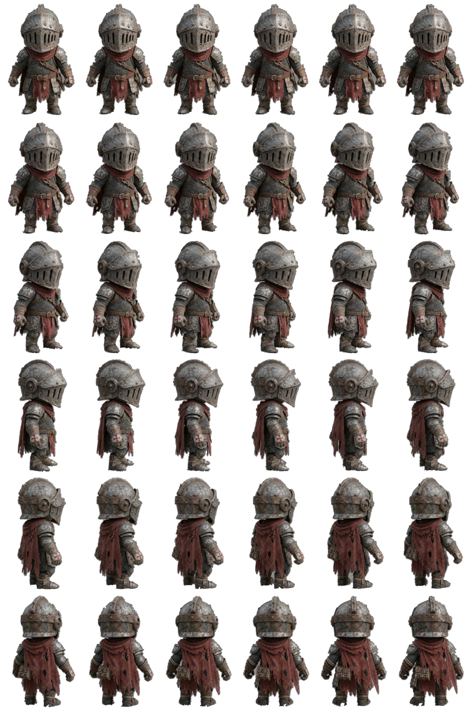

# Canvas Sprite Skeletal Animation (JavaScript)

**Procedural walk-cycle animation for 2D game sprites with pure JavaScript and HTML5 Canvas.**
Turn a single static 360° turnaround sprite into a fully animated, walking, jumping, attacking
game character: no Spine, no DragonBones, no hand-drawn animation frames, no dependencies.

**[▶ Live demo](https://blackmoon87.github.io/canvas-sprite-skeletal-animation-js/)**



## Features

- **Skeletal rig on raw pixels:** a hierarchical bone and joint skeleton (pelvis, spine, neck, head,
  shoulders, elbows, wrists, hips, knees, ankles, toes, heels, tabard and cape) skins the sprite's
  `ImageData` buffer directly.
- **Works from every angle (360°):** 36 pre-rendered angles (72 effective with mirroring).
  The rest pose is fitted to each frame's real turntable angle, so bones line up with the pixels.
- **Realistic gait:** knee hinge flexion in swing, heel-strike → flat foot → heel-off → toe-off,
  contralateral arm swing, pelvis rotation, and a body bob solved from the planted foot (ground IK).
- **No foot sliding:** walk phase speed is matched to stride length.
- **Layered skinning:** each sprite frame is segmented into body parts (head, torso, arms, legs,
  front tabard, back cape). Every part moves only its own pixels and layers are painted back to
  front, so limbs never drag the body along. Hidden torso behind the arm is reconstructed in profile.
- **Fast:** walk poses are quantized and cached, so it runs at full frame rate in a normal game loop.
- **Game-ready object:** `PixelKnight` with 8-direction / mouse movement, jump physics, dash with
  after-images, spin attack, footstep dust, pixel-perfect collision (`hitTestPixel`).
- **Pixel shaders on `ImageData`:** pixelate, neon edge, thermal, hologram, hit flash.
- **Extras:** pixel particle shatter, 3D voxel point cloud, live GIF frame decoding (`ImageDecoder`)
  with de-dither and background keying.

## Quick start

ES modules need a local web server (opening `index.html` from the file system will not work):

```bash
git clone https://github.com/blackmoon87/canvas-sprite-skeletal-animation-js.git
cd canvas-sprite-skeletal-animation-js
python3 -m http.server 8000
# open http://localhost:8000
```

Controls: **WASD / arrows** move · **click** move · **Space** jump · **Shift** dash · **E** spin attack.
In the *Raw ImageData Inspector* tab, enable *Walk-in-Place Demo* and set the rotation to 90° to
study the side-view walk cycle.

## Use it in your game

```js
import { PixelKnight } from './pixel_knight.js';

const player = new PixelKnight({ x: 400, y: 300 });
await player.loadFromSpriteSheet('./knight_spritesheet.png', './knight_atlas.json');

function gameLoop(dt) {
  player.update(dt, { right: keys.ArrowRight, left: keys.ArrowLeft, up: keys.ArrowUp, down: keys.ArrowDown });
  player.draw(ctx, { showSkeleton: false });
}
```

Use the rig directly on any sprite frame:

```js
import { KnightSkeletalRig } from './skeletal_rig.js';

const rig = new KnightSkeletalRig();
const imageData = rig.renderRiggedFrame(frame, walkPhase, walkIntensity, facingDeg);
```

## Files

| File | What it does |
| --- | --- |
| `skeletal_rig.js` | Skeleton, gait kinematics, forward kinematics + ground contact, frame segmentation, layered skinning |
| `pixel_knight.js` | `CanvasPixelProcessor` (keying, shaders, GIF decoding, point cloud) and the `PixelKnight` game object |
| `index.html` | Demo studio: playable arena, particles, voxel view, ImageData inspector |
| `knight_spritesheet.png` / `knight_atlas.json` | 36-angle sprite sheet and its atlas |
| `img.gif` | Source turntable GIF |

## Adapting it to your own sprite

The rig is tuned for the included knight. For another character, adjust in `skeletal_rig.js`:
`restJoints` (bone offsets), `ARM_REST_TABLE` (arm positions per angle), and `VISUAL_YAW_TABLE`
(frame angle → real turntable angle).

## Keywords

JavaScript sprite animation, HTML5 canvas game, procedural animation, 2D skeletal animation,
inverse kinematics, walk cycle, pixel manipulation, ImageData, game development, indie game,
360 degree sprite, no-dependency game engine.

## License

[MIT](LICENSE)
